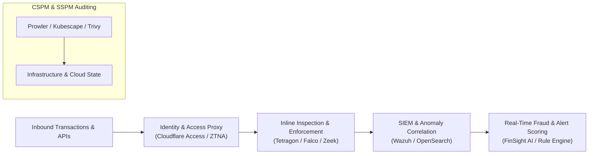

# Awesome Real-Time Transaction Security 🛡️⚡

  
  
  
  
  
  
  

**A curated ecosystem of commercial SaaS products ☁️, enterprise platforms 🏢, and open-source software 🔓 for real-time transaction security, Cloud Access Security Brokers (CASB), continuous transaction monitoring, fraud detection, and Cloud Security Posture Management (CSPM).**

---

## 📑 Contents

- [🌐 Market Landscape & Overview](#-market-landscape--overview)
- [💼 Commercial SaaS & Enterprise Platforms](#-commercial-saas--enterprise-platforms)
- [🔓 Open-Source Projects](#-open-source-projects)
- [🏗️ Architecture & Integration Recipes](#️-architecture--integration-recipes)
- [🤝 How to Contribute](#-how-to-contribute)
- [💖 Support & Community](#-support--community)
- [⭐ Star History](#-star-history)
- [⚖️ Disclaimer & Regulatory Notes](#️-disclaimer--regulatory-notes)

---

## 🌐 Market Landscape & Overview

> 📊 **Market Size & Structure**: The global Cloud Access Security Broker (CASB) and cloud transaction monitoring market is estimated at **$13.9 billion in 2026** and projected to reach **$70.3 billion by 2034 (22.0% CAGR)**; the sector is **moderately fragmented**, with hyperscalers and SSE consolidators coexisting with specialized SSPM and fraud prevention vendors rather than a single winner-take-all monopoly.

Real-time transaction monitoring and access security have transitioned from batch log auditing to inline inspection and automated risk scoring:
- 🛡️ **Zero Trust Network Access (ZTNA) & CASB**: Identity-aware proxies enforce granular contextual policies on every cloud API call and transaction.
- 🔍 **SaaS Security Posture Management (SSPM)**: Continuous detection of misconfigurations, privilege escalation, and token leakage across SaaS estates.
- ⚡ **Runtime & Payment Rail Monitoring**: eBPF-powered container runtime security and streaming AI risk scoring for financial and cloud workloads.

---

## 💼 Commercial SaaS & Enterprise Platforms

The table below lists the top commercial platforms delivering real-time transaction security, CASB, ZTNA, and SSPM. Entries are sorted in **descending order by company size** (market capitalization or latest enterprise valuation).

| 🏢 Platform | 🎯 Primary Focus | 💰 Starting Pricing | 🎁 Free Tier / Trial Limit | 📈 Company Valuation / Revenue |
| :--- | :--- | :--- | :--- | :--- |
| **[Microsoft Defender for Cloud Apps](https://www.microsoft.com/en-us/security/business/cloud-apps-defender)** | CASB, SaaS discovery, and real-time transaction threat protection | $3.50 per user/month (or bundled in Microsoft 365 E5) | 30-day free trial (up to 25 user licenses in M365 tenant) | ~$3.95T Market Cap |
| **[Palo Alto Prisma Cloud](https://www.paloaltonetworks.com/prisma/cloud)** | CNAPP, cloud security posture & transaction workload defense | ~$640 per credit (~$18,000/yr starting CSPM allocation) | 30-day free trial (cloud account onboarding & scan limits) | ~$335B Market Cap |
| **[Salesforce Shield Transaction Security](https://www.salesforce.com/)** | Native CRM transaction policies, real-time API event monitoring | ~10% of Salesforce net spend for Event Monitoring (or 30% for full Shield bundle) | Free forever in Developer Edition orgs (production requires paid add-on) | ~$188B Market Cap |
| **[Cloudflare Access](https://www.cloudflare.com/zero-trust/products/access/)** | Zero Trust access control, identity-aware proxy & API protection | $7.00 per user/month (Pay-as-you-go) | Free forever up to 50 users (24-hour log retention, 2 CASB integrations) | ~$125B Market Cap |
| **[Zscaler Private Access](https://www.zscaler.com/products/zscaler-private-access)** | Zero Trust Network Access (ZTNA) & secure transaction isolation | ~$6.00 to $10.00 per user/month (~$140 to $375/user/year) | 7-day hosted interactive demo / guided sales POC | ~$36B Market Cap |
| **[Netskope Cloud CASB](https://www.netskope.com/)** | Cloud Access Security Broker, inline DLP & API security | ~$4.00 to $8.00 per user/month (Base CASB/SWG tier) | Guided hands-on lab test drive / 30-day enterprise POC | ~$7.2B Valuation ($709M FY26 Revenue) |
| **[Forcepoint ONE (formerly Bitglass)](https://www.forcepoint.com/)** | Unified SSE, CASB reverse proxy & data protection | ~$55.00 per user/year (~$4.58 per user/month; min 100-500 seats) | 14-day assisted trial / customized proof-of-concept | ~$2.45B Valuation (Francisco Partners portfolio) |
| **[AppOmni](https://appomni.com/)** | SaaS Security Posture Management (SSPM) & data leak prevention | ~$7,500/year per block of 100 users per SaaS application | Free community scanner tools / 90-day promotional pilot for Foundations tier | ~$515M Valuation |
| **[Adaptive Shield (CrowdStrike)](https://www.adaptiveshield.com/)** | SSPM, SaaS misconfiguration & identity risk management | Custom enterprise tier via CrowdStrike Falcon | 15-day free trial (no credit card required, posture checks included) | ~$300M Acquisition Valuation |
| **[Wing Security](https://www.wing.security/)** | SaaS shadow IT discovery, automated SSPM & token risk posture | $1,500/year (Compliance tier; Enterprise custom) | Free forever SaaS Pulse discovery tier (basic application risk scan) | ~$29.5M Valuation ($26M total funding) |

---

## 🔓 Open-Source Projects

Top open-source security projects for transaction logging, cloud posture auditing, SIEM log analysis, and runtime transaction inspection. Projects are **sorted by GitHub Stars_Count (descending)**.

- **[Trivy](https://github.com/aquasecurity/trivy)**   
  *Comprehensive security scanner for container images, file systems, Git repositories, virtual machine images, and Kubernetes configurations.* Apache-2.0 licensed. Best for vulnerability and misconfiguration scanning in containerized deployment pipelines. 🐳

- **[Wazuh](https://github.com/wazuh/wazuh)**   
  *Unified SIEM and XDR platform providing real-time security log analysis, integrity monitoring, vulnerability detection, and regulatory compliance.* GPL-2.0 licensed. Features dedicated Indexer, Server, Agent, and Dashboard components. Best for comprehensive on-premise and cloud SIEM. 🔎

- **[Prowler](https://github.com/prowler-cloud/prowler)**   
  *Open-source cloud security assessment tool supporting AWS, Azure, GCP, and Kubernetes.* Apache-2.0 licensed. Ships with 800+ checks mapped against 30+ compliance frameworks (PCI-DSS, CIS, NIST 800, FedRAMP, SOC2). Best for multi-cloud security posture management (CSPM). ☁️

- **[OpenSearch](https://github.com/opensearch-project/OpenSearch)**   
  *Community-driven search and analytics suite equipped with Security Analytics detectors for real-time threat detection and forensic correlation.* Apache-2.0 licensed. Best for high-throughput security event and transaction log search. 🔍

- **[Kubescape](https://github.com/kubescape/kubescape)**   
  *CNCF-incubating Kubernetes security platform.* Apache-2.0 licensed. Provides posture assessment, automated risk analysis, and eBPF-driven runtime threat detection against NSA-CISA and MITRE ATT&CK benchmarks. Best for Kubernetes cluster posture and runtime security. ☸️

- **[Falco](https://github.com/falcosecurity/falco)**   
  *CNCF-graduated cloud-native runtime security monitor.* Apache-2.0 licensed. Uses kernel tracing and eBPF to detect abnormal application behavior, suspicious syscalls, and privilege escalation in real time. Best for cloud-native runtime transaction auditing. 🦅

- **[Checkov](https://github.com/bridgecrewio/checkov)**   
  *Static code analysis tool for Infrastructure as Code (IaC).* Apache-2.0 licensed. Audits Terraform, CloudFormation, Kubernetes, Helm, and ARM templates for security and compliance misconfigurations prior to provisioning. ✅

- **[kube-bench](https://github.com/aquasecurity/kube-bench)**   
  *Automated CIS Kubernetes Benchmark assessment tool.* Apache-2.0 licensed. Verifies whether Kubernetes clusters are deployed in accordance with CIS security best practices. 📏

- **[Zeek](https://github.com/zeek/zeek)**   
  *Deep network analysis framework and network transaction logging platform.* BSD-3-Clause licensed. Translates raw network packets into structured application-layer transaction events (HTTP, DNS, SSL/TLS) for forensic analysis and real-time anomaly detection. 🌐

- **[ScoutSuite](https://github.com/nccgroup/ScoutSuite)**   
  *Multi-cloud security auditing tool from NCC Group.* GPL-2.0 licensed. Inspects AWS, Azure, GCP, Alibaba Cloud, and Oracle Cloud environments using public cloud APIs, generating interactive HTML vulnerability reports. 🧭

- **[Suricata](https://github.com/OISF/suricata)**   
  *High-performance Network IDS, IPS, and Network Security Monitoring engine.* GPL-2.0 licensed. Delivers real-time packet inspection, multi-threaded wire speed analysis, and automatic rule-based threat mitigation. 🚨

- **[Tetragon](https://github.com/cilium/tetragon)**   
  *eBPF-based security observability and real-time runtime enforcement tool.* Apache-2.0 licensed. Intercepts kernel namespaces, capabilities, and system calls to block malicious processes synchronously without user-space latency. ⚡

- **[DefectDojo](https://github.com/DefectDojo/django-DefectDojo)**   
  *Open-source DevSecOps orchestration and vulnerability management platform.* BSD-3-Clause licensed. Normalizes findings across 150+ security scanners to track remediation pipelines and audit readiness. 🥋

- **[Security Onion](https://github.com/Security-Onion-Solutions/securityonion)**   
  *Integrated Linux distribution for threat hunting, enterprise security monitoring, and log management.* Elastic License 2.0. Bundles Suricata, Zeek, Wazuh, and OpenSearch with unified analyst web interfaces. 🧅

- **[Security Monkey](https://github.com/Netflix/security_monkey)**   
  *Legacy policy monitoring and change auditing architecture from Netflix.* Apache-2.0 licensed. Continuously tracks AWS/GCP policy modifications and insecure changes over time. 🐒

- **[Cartography](https://github.com/lyft/cartography)**   
  *Graph-based asset discovery and relationship mapping tool from Lyft.* Apache-2.0 licensed. Ingests infrastructure assets into Neo4j to illustrate complex attack paths and multi-hop transactional access risks. 🗺️

- **[CloudSploit](https://github.com/aquasecurity/cloudsploit)**   
  *Cloud security posture and configuration scanner for AWS, Azure, GCP, and Oracle Cloud.* BSD-3-Clause licensed. Identifies misconfigurations and unauthorized public exposures. 🎯

- **[RITA (Real Intelligence Threat Analytics)](https://github.com/activecm/rita)**   
  *Open-source network traffic analysis framework for detecting command and control (C2) communication.* LGPL-3.0 licensed. Parses Zeek transaction logs to uncover beaconing behavior and DNS tunneling. 📡

- **[Clouditor](https://github.com/clouditor/clouditor)**   
  *Continuous cloud assurance and automated compliance engine.* Apache-2.0 licensed. Features Cloud Compliance Language (CCL) to evaluate multi-cloud workloads against BSI C5 and CSA CCM frameworks. 📋

- **[FinSight AI](https://github.com/AwaisRehman/finsight-ai)**   
  *AI-powered financial transaction monitoring and analytics dashboard.* MIT licensed. Integrates MongoDB Atlas transaction streaming with LLaMA 3.3 70B for conversational transaction fraud screening and rule-based risk evaluation. 🤖

---

## 🏗️ Architecture & Integration Recipes

To build a modular self-hosted transaction security stack:

1. 🚪 **Ingress & Proxy Layer**: Utilize [Cloudflare Access](https://www.cloudflare.com/zero-trust/products/access/) or identity-aware proxies to enforce strict mutual TLS and token validation on all transaction endpoints.
2. ⚡ **Kernel & Network Wire Inspection**: Deploy [Tetragon](https://github.com/cilium/tetragon) and [Zeek](https://github.com/zeek/zeek) to capture system calls and application-level transaction records in real time.
3. 📥 **Log Ingestion & SIEM Correlation**: Pipe transaction logs into [Wazuh](https://github.com/wazuh/wazuh) or [OpenSearch](https://github.com/opensearch-project/OpenSearch) to detect anomalous transaction bursts, credential stuffing, and unauthorized data queries.
4. 🔄 **Continuous Posture Auditing**: Schedule [Prowler](https://github.com/prowler-cloud/prowler) and [Kubescape](https://github.com/kubescape/kubescape) to enforce compliance standards (PCI-DSS, SOC 2, ISO 27001).

---

## 🤝 How to Contribute

Contributions are warmly welcomed! 🌟 To suggest a product or open-source tool:

1. 🍴 Fork this repository.
2. 📝 Ensure entries conform to formatting standards (include exact pricing/trial bounds for SaaS, and valid Stars_Badge URLs for open source).
3. 🚀 Open a Pull Request detailing the product's primary transaction security or posture capabilities.

---

## 💖 Support & Community

Thank you for exploring and using **Awesome Real-Time Transaction Security**! 💫

If you find this curated resource helpful for your projects, architecture reviews, or security research, please consider supporting the project:
- ⭐ **Star this repository** to help others discover it!
- 🍴 **Fork and contribute** new tools, corrections, or architecture patterns.
- 📢 **Share with colleagues** in DevOps, FinTech, and cybersecurity communities.
- ☕ **Buy a coffee & sponsor**: If this project saved you time or aided your research, you can support future maintenance via the [GitHub Sponsor Dashboard](https://github.com/sponsors/ishandutta2007).

---

## ⭐ Star History

---

## ⚖️ Disclaimer & Regulatory Notes

- 📜 **Compliance Standards**: Real-time transaction platforms operate under strict regulatory standards (e.g., PCI-DSS for payment cards, SOX for corporate financial systems, and GDPR/CCPA for personally identifiable data).
- 🛡️ **Enforcement Boundaries**: Open-source tools excel at continuous posture assessment, forensic packet capture, and telemetry analysis. For guaranteed inline latency SLAs and turnkey CASB policy blocking across thousands of unmanaged SaaS apps, commercial SSE suites remain prevalent.
- ℹ️ **Verification**: Pricing tiers, trial conditions, and company valuations reflect market data as of October 2026. Always confirm active quotes directly with respective providers.
